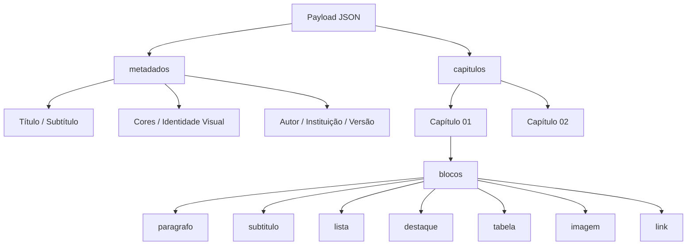

# Guia de Especificação do Schema JSON (Padrão API)

Este documento descreve as regras para integração com o **Gerador de Apostilas em PDF**. Qualquer sistema externo (n8n, APIs FastAPI/Node, scripts em Python ou IAs como Gemini/ChatGPT) pode gerar e enviar este payload para produção automatizada de PDFs.

---

## 1. Visão Geral da Arquitetura de Dados

O documento é dividido em 2 grandes nós:
1. **`metadados`**: Define a identidade visual global, autoria e dados da capa.
2. **`capitulos`**: Array contendo os capítulos do material didático. Cada capítulo possui seu próprio conjunto de `blocos`.



---

## 2. Dicionário de Campos: `metadados`

| Campo | Tipo | Obrigatório? | Descrição |
| :--- | :--- | :---: | :--- |
| `titulo` | String | **Sim** | Título principal da apostila (aparece na capa e no topo do documento). |
| `subtitulo` | String | Não | Subtítulo ou tema complementar. |
| `autor` | String | Não | Nome do autor, professor ou especialista. |
| `instituicao` | String | Não | Nome da empresa, escola ou comunidade. |
| `versao` | String | Não | Número da versão ou data da edição (ex: `"1.0 - 2026"`). |
| `logo_path` | String | Não | Caminho relativo da imagem do logotipo (ex: `"assets/logo.png"`). |
| `cor_primaria` | String (Hex) | Não | Cor de destaque primária (padrão: `"#0056b3"`). Define o gradiente da capa, títulos e cabeçalhos de tabela. |
| `cor_secundaria` | String (Hex) | Não | Cor de apoio (padrão: `"#00a8e8"`). Usada em tags, barras de títulos e links. |

---

## 3. Catálogo de Tipos de `blocos`

Cada bloco dentro da lista `blocos` deve possuir obrigatoriamente a propriedade `"tipo"`.

### 3.1. `paragrafo`
Usado para textos corridos. Suporta marcação HTML inline (`<strong>`, `<em>`, `<code>`, etc.).
```json
{
  "tipo": "paragrafo",
  "conteudo": "Texto explicativo detalhado sobre a matéria."
}
```

### 3.2. `subtitulo`
Usado como divisória de assuntos dentro de um mesmo capítulo (renderiza como `<h3>`).
```json
{
  "tipo": "subtitulo",
  "conteudo": "Fundamentos da Comunicação HTTP"
}
```

### 3.3. `lista`
Lista de tópicos. Pode ser `"bullet"` (com marcadores) ou `"numerada"` / `"ol"`.
```json
{
  "tipo": "lista",
  "estilo": "bullet",
  "itens": [
    "Primeiro item da listagem",
    "Segundo item da listagem"
  ]
}
```

### 3.4. `destaque`
Card estilizado para notas, alertas ou resumos conceituais.
```json
{
  "tipo": "destaque",
  "titulo": "Dica de Ouro",
  "conteudo": "Certifique-se de tratar exceções para evitar paradas inesperadas no fluxo."
}
```

### 3.5. `tabela`
Estrutura tabular com cabeçalhos e linhas. O layout aplica zebrado e regras contra quebra de página no meio de linhas.
```json
{
  "tipo": "tabela",
  "cabecalhos": ["Coluna A", "Coluna B"],
  "linhas": [
    ["Valor 1", "Valor 2"],
    ["Valor 3", "Valor 4"]
  ]
}
```

### 3.6. `imagem`
Exibe diagramas, esquemas ou ilustrações centralizadas com legenda.
```json
{
  "tipo": "imagem",
  "caminho": "assets/diagrama_exemplo.png",
  "legenda": "Figura 1: Arquitetura de microserviços",
  "largura": "85%"
}
```

### 3.7. `link`
Gera um link clicável formatado.
```json
{
  "tipo": "link",
  "texto": "Clique aqui para acessar o repositório",
  "url": "https://github.com"
}
```

---

## 4. Arquivos Criados no Projeto
- Molde JSON comentado: [molde_schema_modelo.json](file:///c:/Users/igorl/Desktop/gerador-de-apostila/data/molde_schema_modelo.json)
- Documentação técnica do Schema: [SCHEMA_GUIA.md](file:///c:/Users/igorl/Desktop/gerador-de-apostila/data/SCHEMA_GUIA.md)
